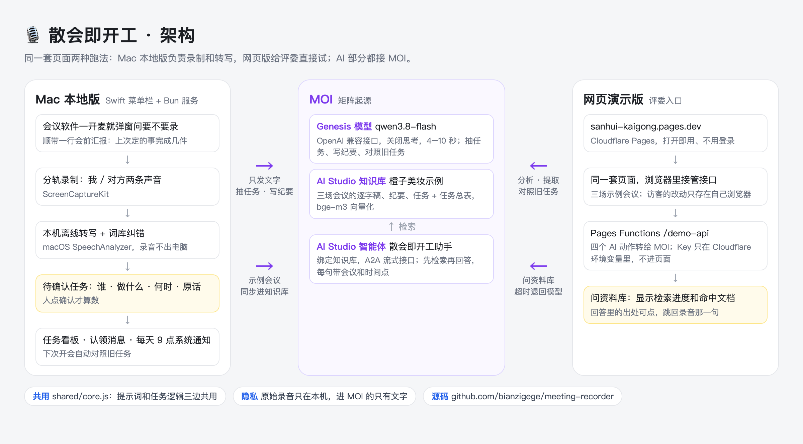
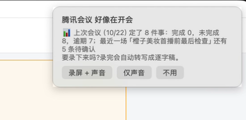
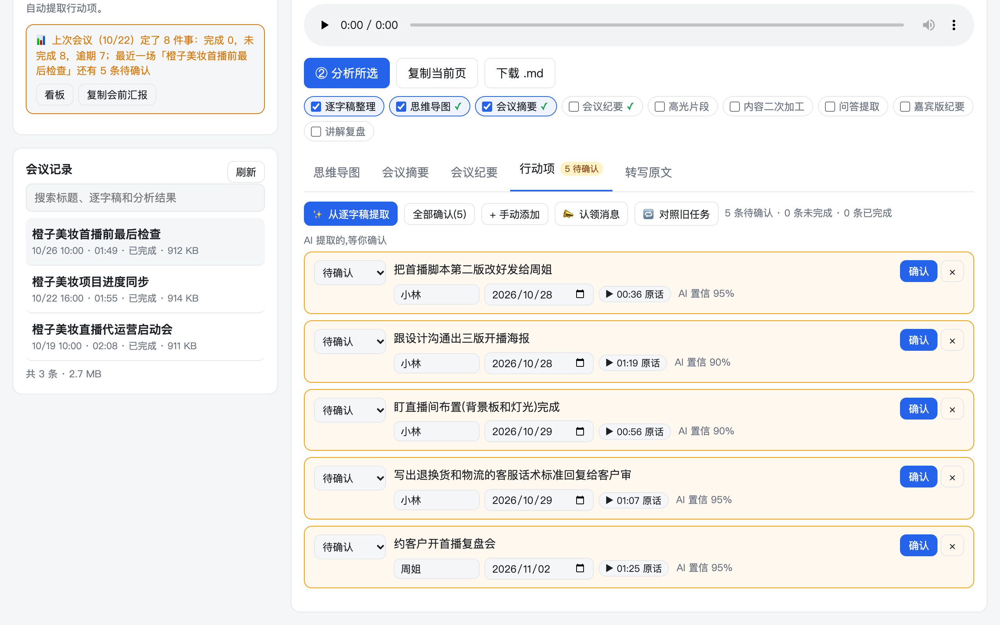
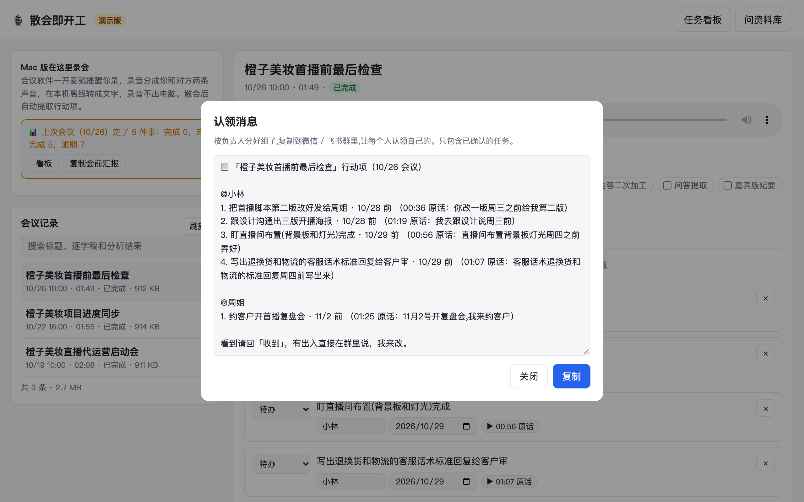
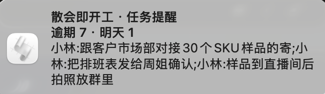
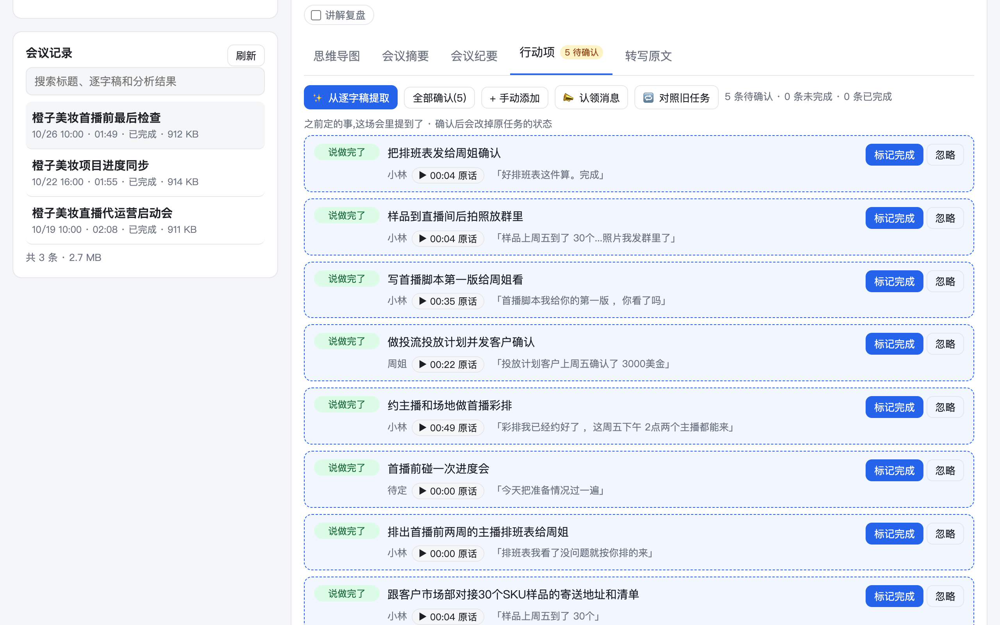
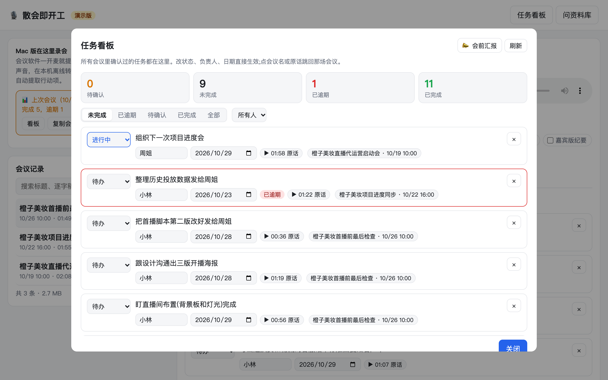
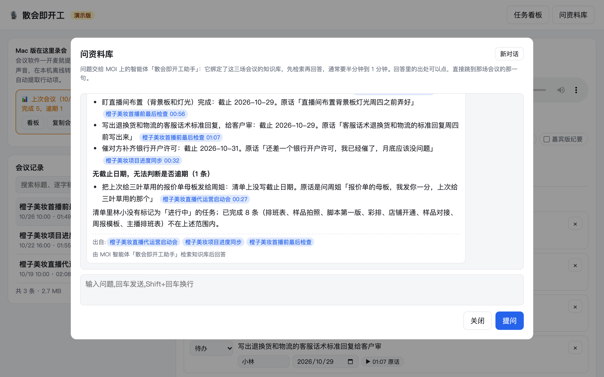
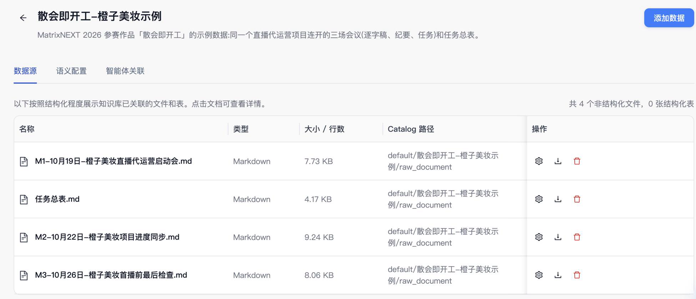
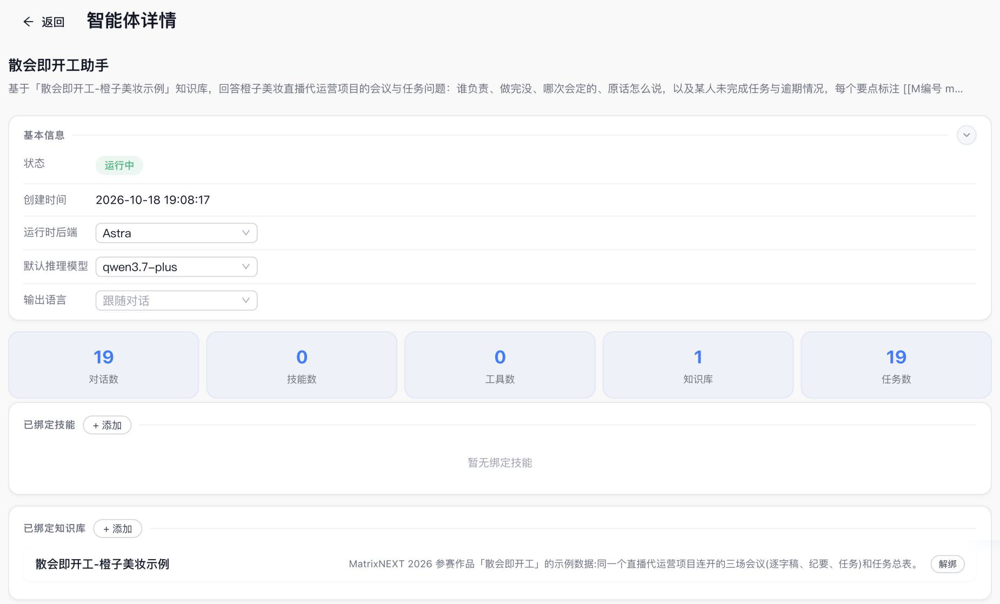

# 散会即开工 · 作品说明文档

> MatrixNEXT 2026 创意赛道「会议变行动」参赛作品。下面依次是：问题、方案、技术栈、创新点、使用说明、效果数据。

- **作品名**：散会即开工
- **赛道**：创意赛道 · 会议变行动
- **团队**：待补充（队长 GitHub：bianzigege）
- **可运行链接**：https://sanhui-kaigong.pages.dev（打开即用，无需登录）
- **MOI 智能体**：「散会即开工助手」（工作区内智能体 ID b7f3c1d2-4e58-4a91-9c6d-2f0a8e5b7c31），绑定知识库「散会即开工-橙子美妆示例」（编号 10001）。网页版的「问资料库」就是在调用它。
- **源码**：https://github.com/bianzigege/meeting-recorder
- **演示视频**：待补充（≤3 分钟，上传后放链接）
- **访问密码**：无

---

## 1. 问题

开完会之后的三件事没人做好：

1. **没人写纪要**。会上定的事散会就忘，写了也没人看。
2. **任务没有家**。该谁做、什么时候交，散在纪要、群聊和各人脑子里，没有一个地方能看到「上次会定的 7 件事现在做完几件」。
3. **追溯靠翻**。「这个决定是哪次会定的、当时为什么这么定」要翻半天记录，经常翻不到。

现有的 AI 纪要工具解决的是第 1 件，生成一份文档就结束了。任务不会跨会议活着，也不会有人去催。

## 2. 方案

散会即开工把一场会议变成一组**会活的任务**：

```
录制（Mac 原生，分轨「我 / 嘉宾」）
  → 本地离线转写（原始录音不出本机）
  → 任务抽取（MOI Genesis 模型）：谁、做什么、什么时候，每条带原话出处
  → 人工确认（AI 提、人确认，改负责人 / 改日期 / 删）
  → 认领消息 + 到期提醒（每天定时的 macOS 系统通知）
  → 下次开会前汇报：上次 N 件事完成几件，会中说到「弄完了」自动标完成候选
  → 跨会议追溯（MOI 知识库 + 智能体）：「报价单是哪次会定的？」带出处回答
```

### 2.1 核心流程



**① 开会前：会议软件一开麦就问要不要录，顺带汇报上次的事做完几件**（Mac 版）



**② 散会后：AI 提出任务，先放进待确认**。谁做、做什么、什么时候交，每条带原话和时间点，点一下就从录音那一句开始播；负责人和日期都能改，人点确认才算数。



**③ 确认后：按负责人分组生成认领消息**，复制到群里。



**④ 之后每天定时提醒**：逾期、今天到期、明天到期的任务汇成一条系统通知（Mac 版）。



**⑤ 下次开会：转写一完成，自动拿旧任务和新录音对一遍**。会上说「做完了」的，提示标成完成，带原话。



**⑥ 任务看板**：跨会议看全部任务，逾期标红，点出处跳回定下它的那场会。



**⑦ 问资料库：问题交给 MOI 智能体**，它检索知识库后回答，每句标出是哪场会、第几分钟。



### 2.2 MOI 的使用
| 环节 | MOI 能力 | 说明 |
|---|---|---|
| 任务抽取、纪要生成 | Genesis 模型调用 | qwen3.8-flash，OpenAI 兼容接口 /chat/completions；网页版关闭思考，4–10 秒出结果 |
| 跨会议知识库 | AI Studio 知识库 | 知识库「散会即开工-橙子美妆示例」：三场会议（逐字稿、纪要、本场任务）+ 任务总表，bge-m3 向量化；脚本一键同步 |
| 对外问答 | AI Studio 智能体 | 「散会即开工助手」绑定知识库；网页版问资料库通过 A2A 流式接口调用它，访客当前任务状态随问题发送，页面实时显示检索进度和命中文档；10/18 实测 38–72 秒（调用时指定模型 deepseek-v4.1-flash）；超过 2 分钟没答完，自动改用 Genesis 模型直接回答 |

转写不走 MOI：Mac 版在本机离线转写，录音不出电脑；网页版只放三场已转写的示例会议，不提供上传。

MOI 控制台里的知识库（4 份文档：三场会议 + 任务总表）和智能体（绑定 1 个知识库，没有挂别的技能和工具）：





### 2.3 数据流与隐私
- 本地版：录音、转写都在本机；只有逐字稿文本和任务进 MOI。
- 线上版：只放三场示例会议，不能上传；访客的改动只存在自己的浏览器里。AI 动作只把示例会议的文字发给 MOI，MOI 的 Key 只在 Cloudflare 环境变量里，不进页面。
- 示例会议是专门写的演示剧本，用 macOS 语音合成录制，不含真实业务数据。

## 3. 技术栈

| 层 | 技术 |
|---|---|
| Mac 录制 | Swift，ScreenCaptureKit，麦克风与系统声音分轨，菜单栏常驻，全局快捷键 |
| 本地转写 | macOS 26 SpeechAnalyzer，离线，词库纠错 |
| 服务 | Bun + TypeScript，SSE 流式输出，ffmpeg 合成 |
| 模型 | MOI Genesis qwen3.8-flash（关闭思考）；智能体用 deepseek-v4.1-flash；本地版可切 Claude Code 账号 / Anthropic API |
| 知识与智能体 | MOI AI Studio 知识库 + 智能体 |
| 线上版 | Cloudflare Pages + Pages Functions；同一套页面，浏览器里接管接口，AI 动作走云端函数调用 MOI Genesis（qwen3.8-flash，关闭思考） |
| 提醒 | macOS 系统通知，每天定时汇总逾期 / 今天 / 明天到期 |
| 前端 | 原生 HTML / JS，Markmap 思维导图 |

架构图见 2.1。

## 4. 创新点

1. **任务跨会议活着**：不是每次开会生成一张新清单，而是持续跟踪到完成；下次开会前自动汇报完成情况，会中提到「弄完了」自动标记。
2. **每条任务可回听原话**：任务带来源时间戳，一点跳回录音那一句，解决「当时为什么这么定」。
3. **AI 提、人确认**：抽取结果先进待确认列表，避免 AI 幻觉直接变成别人的任务。
4. **隐私优先**：原生分轨录制 + 本地离线转写，原始录音不上传；只有文本进 MOI。
5. **零操作进入**：会议软件一用麦克风就提醒录制，散会自动转写、抽任务。

## 5. 使用说明

### 5.1 线上版（评委请从这里开始）
1. 打开 https://sanhui-kaigong.pages.dev 。页面直接打开第三场会议的「行动项」，演示时间固定在 2026-10-27（第三场会议的第二天）。
2. 三场示例会议是同一个项目连着开的：启动会 10/19 → 进度同步 10/22 → 首播前检查 10/26。网页版不支持上传录音，录制和转写在 Mac 版完成。
3. 查看「行动项」待确认列表 → 确认或修改 → 进入看板。
4. 点任务旁的「来源」回听原话；点「认领消息」复制给团队。
5. 点右上角「问资料库」提问，例如「小林手上还有什么没做完？」。问题交给 MOI 智能体，1 分钟左右回答，出处可点。
6. 点右上角「任务看板」看全部任务和逾期。到期提醒是 Mac 版的系统通知，网页版不发。

### 5.2 MOI 智能体
1. 网页版点「问资料库」提问，问题就交给 MOI 智能体「散会即开工助手」，等 1 分钟左右，回答下方会标「由 MOI 智能体检索知识库后回答」。
2. 有 MOI 账号的评委也可以在 MOI 控制台的工作区里直接使用这个智能体（需要被邀请进工作区）。

### 5.3 本地版（Mac）
见仓库 README：https://github.com/bianzigege/meeting-recorder

需要 macOS 26+、Bun、ffmpeg、Chrome。`./build-app.sh` 安装到 ~/Applications 后常驻菜单栏。

## 6. 效果数据

- **真实会议**：我自己一场 22 分钟的工作会议（逐字稿约 1.9 万字，含时间戳和说话人），散会后 46 秒提出 7 件事，负责人、截止时间、原话出处都对得上（本地版，当时模型用的是 Claude 账号）。
- **网页版（MOI）**：示例会议每场约 2 分钟，提取任务、生成纪要 4–10 秒（Genesis qwen3.8-flash，关闭思考）；问资料库交给 MOI 智能体，10/18 实测 38–72 秒。
- **对比人工**：待补充。原来散会后整理纪要、追任务要多久。

## 7. 团队与分工

待补充
